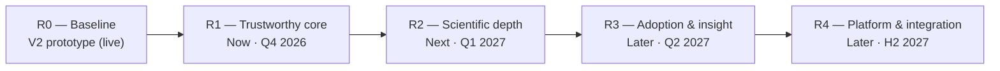

# Product Roadmap

| Document ID | PS-02 | Version | 0.1 | Status | Draft | Owner | H.-P. Konan |
|---|---|---|---|---|---|---|---|

The roadmap is outcome-based and uses a **Now / Next / Later** horizon. Dates are indicative and assume part-time capacity of a single maker; they will be re-planned after each release.

## Roadmap overview

## R0 — Baseline (live)

What exists today ("Jess Multiplex Assistant V2"):
- 5-question progressive decision flow (Q1–Q5) leading to 8 distinct outcomes (O1–O8).
- Recommendation card with status badge, decision-type badge, rationale, practical tips and reagent notes (collapsible).
- Progress bar, reset button, copy-to-clipboard.
- Static hosting on GitHub Pages with automatic deployment on push to `main`.

Known limitations: see `03-functional-rules/06-known-logic-issues.md` and `05-solution-architecture/04-technical-debt-register.md`.

## NOW — R1 "Trustworthy core" (target: end of Q4 2026)

**Outcome:** every recommendation is correct, tested and traceable; the codebase is safe to evolve.

| Theme               | Key deliverables                                                                                    | Epics  |
| ------------------- | --------------------------------------------------------------------------------------------------- | ------ |
| Decision integrity  | Rules extracted from UI code into a versioned rule file; pure evaluation function                   | E1     |
| Quality             | Automated tests covering 100% of decision paths (R-01 to R-11) and UI behaviours                    | E5     |
| Scientific sign-off | Decision table reviewed by at least two SMEs; open questions SQ-01 to SQ-05 triaged                 | E2, E7 |
| Fixes               | Logic issues LI-01 to LI-07 corrected (badge mismatch, duplicate numbering, author-facing wording…) | E1, E4 |
| Hygiene             | Single source of truth (remove duplicate/unused files), README, licence, rule version displayed     | E6     |
| Usability           | Responsive layout, accessible form controls                                                         | E4     |

**Release gate:** all Must items done; all decision paths green in CI; SME sign-off recorded in the decision log.

## NEXT — R2 "Scientific depth" (target: Q1 2027)

**Outcome:** the tool covers the most common real-world two-target scenarios without escalation.

| Theme             | Key deliverables                                                                                  | Epics  |
| ----------------- | ------------------------------------------------------------------------------------------------- | ------ |
| Dual fluorescence | Recommend NIR + IR multiplexing where appropriate (SQ-01)                                         | E2     |
| Abundance         | Ask about relative target abundance and adapt the recommendation (SQ-02)                          | E2     |
| MW precision      | Optional entry of expected apparent MW of each target, with separation-module hint (SQ-03, SQ-04) | E2     |
| Normalization     | Option to include total protein detection via RePlex (SQ-05)                                      | E2     |
| Output            | Printable/exportable summary including rule version and date                                      | E3     |
| Reagents          | Reagent catalogue held as data with verified references                                           | E2, E7 |

## LATER — R3 "Adoption & insight" (target: Q2 2027)

**Outcome:** the tool is used by a pilot group and generates evidence for a go/no-go on wider adoption.

| Theme | Key deliverables | Epics |
|---|---|---|
| Measurement | Privacy-friendly, anonymous usage analytics (outcome reached, drop-off step) | E8 |
| Feedback | In-app "Was this helpful?" and "Report an issue" | E8 |
| Pilot | Onboarding of 5–10 FAS / Technical Support colleagues; pilot review | E9 |
| Governance | Content ownership, review cadence, disclaimer and branding agreed with management | E7 |

## LATER — R4 "Platform & integration" (H2 2027, subject to Stage 2 approval)

- Localization (French, German, others) using externalized strings.
- Reuse of the decision engine in other internal tools (for example a searchable base of documented Jess experiments, or demo-report generation).
- Extension study: more than two targets; other Simple Western instruments.
- Hosting under an approved company channel if the tool is endorsed.

## Roadmap risks and dependencies

| Dependency | Needed for | Mitigation |
|---|---|---|
| SME availability for scientific review | R1 sign-off, R2 new rules | Short, structured review sessions using the decision table; asynchronous comments |
| Management position on official status | R3 pilot, R4 | Keep Stage 0/1 scope personal and disclaimer-protected until approval |
| Verified reagent references | R2 reagent catalogue | Verification owner and date per reagent (see `02-scientific-constraints/03-reagent-reference.md`) |
