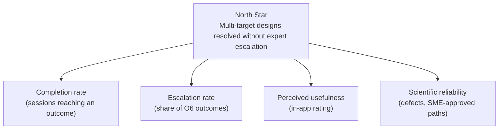

# OKRs and Success Metrics

| Document ID | PS-03 | Version | 0.1 | Status | Draft | Owner | H.-P. Konan |
|---|---|---|---|---|---|---|---|

> Targets below are **proposed starting values**. They must be recalibrated once a baseline is measured (no usage data is collected today).

## 1. Metric hierarchy

**North Star Metric — "Resolved designs":** number of sessions per month that end on a validated recommendation (O2–O5, O7, O8) or a validation step (O1), rather than on an escalation (O6) or abandonment.

Why: it captures both user value (a usable answer) and business value (one less expert interaction).

## 2. OKRs — R1 "Trustworthy core" (Q4 2026)

**Objective 1 — Make every recommendation scientifically trustworthy.**

| Key result | Baseline | Target |
|---|---|---|
| KR1.1 Decision paths covered by automated tests | 0 / 11 | 11 / 11 |
| KR1.2 Decision paths reviewed and approved by ≥ 2 SMEs | 0 / 11 | 11 / 11 |
| KR1.3 Known logic issues open (LI-xx, severity High/Medium) | 4 | 0 |
| KR1.4 Reagent references with a recorded verification date | 0 / 7 | 7 / 7 |

**Objective 2 — Make the product safe to evolve.**

| Key result | Baseline | Target |
|---|---|---|
| KR2.1 Scientific rules editable without touching UI code | No | Yes |
| KR2.2 Duplicate / unused source files in the repository | 7 | 0 |
| KR2.3 CI pipeline blocks deployment when a test fails | No | Yes |

## 3. OKRs — R3 "Adoption & insight" (Q2 2027, pilot)

**Objective 3 — Prove that the tool saves expert time and prevents failed runs.**

| Key result | Target (proposal) |
|---|---|
| KR3.1 Active pilot users (FAS / Technical Support) | ≥ 8 |
| KR3.2 Completion rate (session → outcome) | ≥ 80 % |
| KR3.3 Average usefulness rating | ≥ 4 / 5 |
| KR3.4 Pilot users reporting at least one avoided support escalation or failed run | ≥ 50 % |
| KR3.5 Escalation outcome (O6) share | ≤ 15 % of completed sessions (higher values reveal coverage gaps to address) |

## 4. Metric catalogue

| ID | Metric | Definition | Source | Frequency |
|---|---|---|---|---|
| M-01 | Sessions | Page loads with at least one answer given | Analytics (R3) | Weekly |
| M-02 | Completion rate | Sessions reaching any outcome ÷ sessions | Analytics | Weekly |
| M-03 | Drop-off step | Last question answered in non-completed sessions | Analytics | Monthly |
| M-04 | Outcome distribution | Share of each outcome O1–O8 | Analytics | Monthly |
| M-05 | Escalation rate | O6 ÷ completed sessions | Analytics | Monthly |
| M-06 | Copy rate | Sessions using "Copy recommendation" ÷ completed sessions | Analytics | Monthly |
| M-07 | Usefulness | Mean of in-app rating (1–5) | Feedback widget | Monthly |
| M-08 | Logic defects | Open defects classified as scientific/logic | Issue tracker | Per release |
| M-09 | SME coverage | Paths approved ÷ total paths | Decision log | Per release |
| M-10 | Time-to-recommendation | Median time from first answer to outcome | Analytics | Monthly |
| M-11 | Expert time saved (qualitative → quantitative) | Self-reported minutes saved per week by pilot FAS/TS | Pilot survey | End of pilot |

## 5. Measurement principles

- **No personal data**: no names, emails, IP-based identification, institutions or sample information are collected (see NFR-07).
- Analytics are aggregate and anonymous; events carry only the question/outcome IDs and the rule-set version.
- Qualitative evidence (pilot interviews, anecdotes of avoided failed runs) complements quantitative metrics, as volumes will be small.
