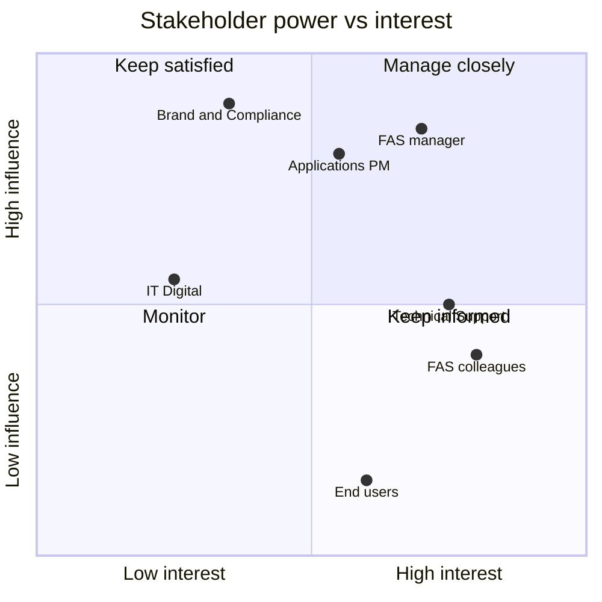

# Stakeholders and RACI

| Document ID | PS-04 | Version | 0.1 | Status | Draft | Owner | H.-P. Konan |
|---|---|---|---|---|---|---|---|

## 1. Stakeholder map

| Stakeholder | Interest | Influence | Current stance (assumption) | Engagement strategy |
|---|---|---|---|---|
| Product owner / maker (H.-P. Konan) | Build a useful, credible tool; demonstrate product skills | High | Champion | Owns vision, backlog, releases |
| FAS manager | Team productivity, KPIs, field responsibilities preserved | High | Neutral — not an official project; acceptable if it serves the business | Short monthly update focused on time saved and customer impact; no extra workload for the team |
| FAS colleagues | Faster, consistent advice in the field | Medium | Potential early adopters | Invite to R3 pilot; collect feedback |
| Technical Support team | Fewer repetitive design questions; correct escalations | Medium | Unknown | Involve as SME reviewers of escalation rules (O6) |
| Applications / Product Management (instrument) | Scientific accuracy, consistency with official documentation | High | Unknown | Formal review before Stage 2; align with application notes |
| Marketing / Brand & Compliance | Correct use of brand, disclaimers, product claims | High (veto) | Unknown | Consult before any wider distribution; agree on disclaimer and hosting |
| IT / Digital | Hosting, security, data protection | Medium | Not engaged | Engage only at Stage 2 |
| Jess end users (customers) | Faster, successful experiments | Low (today) | Indirect beneficiaries | Reached through FAS / TS usage during Stages 0–2 |

## 2. Power–interest grid

## 3. RACI matrix

R = Responsible, A = Accountable, C = Consulted, I = Informed

| Activity | Product owner | FAS manager | SME reviewers (FAS / TS / Apps) | Brand & Compliance | IT |
|---|---|---|---|---|---|
| Product vision and roadmap | A/R | C | C | I | – |
| Backlog prioritization | A/R | C | C | – | – |
| Scientific rule definition | R | I | A* | – | – |
| Scientific rule approval (sign-off) | R | I | A | – | – |
| Reagent reference verification | R | – | A | – | – |
| UI / UX design | A/R | – | C | C | – |
| Development and testing | A/R | – | – | – | – |
| Release to production (GitHub Pages) | A/R | I | I | – | – |
| Disclaimer, branding, distribution scope | R | A | – | C | C |
| Pilot organization (R3) | R | A | C | – | – |
| Stage 2 hosting and data protection | C | A | – | C | R |

\* For scientific content, accountability sits with the reviewing SME group once nominated; until then the product owner acts as both author and first reviewer, and this must be recorded as such in the decision log.

## 4. Communication plan

| Audience | Format | Cadence | Content |
|---|---|---|---|
| FAS manager | 1-page update | Monthly / per release | Outcomes, metrics, time saved, next step, asks |
| SME reviewers | Review session on the decision table | Per rule change | Changed rules, test scenarios, open questions |
| Pilot users | Release note + short demo | Per release | What changed, how to give feedback |
| All | Changelog in repository | Per release | Version, changes, rule-set version |
