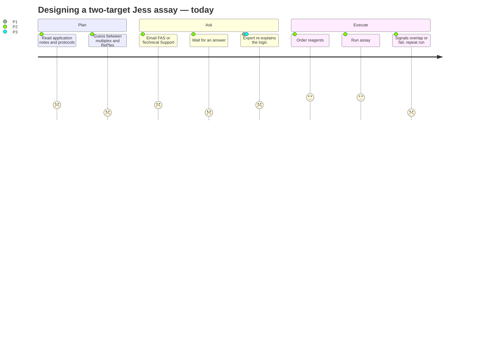
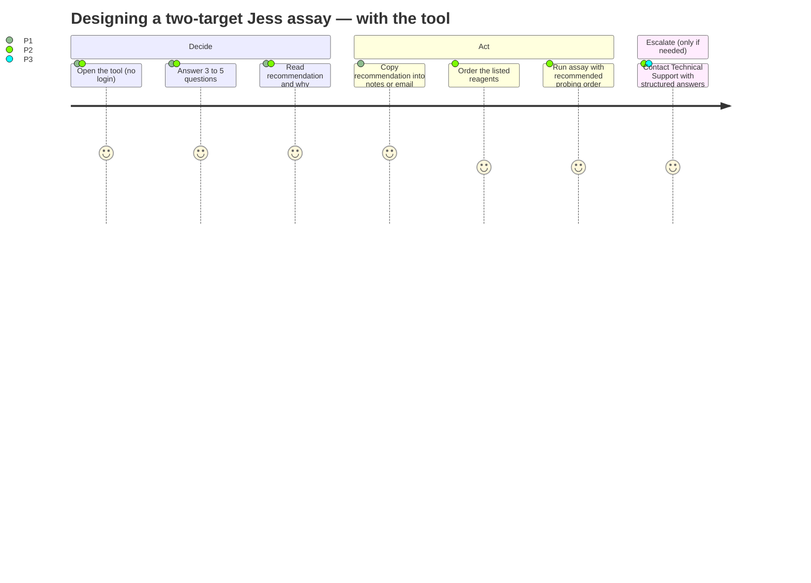

# User Journeys

| Document ID | UR-DOC-02 | Version | 0.1 | Status | Draft | Owner | H.-P. Konan |
|---|---|---|---|---|---|---|---|

## 1. Current journey without the tool (P2 bench scientist, supported by P1/P3)

**Pain points**
- Multiple information sources; no single structured path.
- Waiting time for an expert answer.
- Failed runs when co-migrating targets are multiplexed in chemiluminescence, or when multiplexing is attempted before single-target validation.

## 2. Target journey with the tool

## 3. Key scenarios

| ID | Scenario | Persona | Expected outcome |
|---|---|---|---|
| JS-01 | During a training, a customer asks how to measure p-protein and total protein that co-migrate | P1 | Tool recommends RePlex (both chemi) or mixed HRP + NIR detection (distinct species) with reasons |
| JS-02 | A customer emails asking whether they can multiplex a loading control and a target of different MW | P3 | Tool recommends chemi multiplex with the right secondary configuration; TS copies the recommendation into the reply |
| JS-03 | A new user has not yet run either antibody alone | P2 / P4 | Tool stops the user and recommends single-target validation first, with tips |
| JS-04 | A user has a goat primary and a mouse primary | P2 / P3 | Tool routes to Technical Support instead of guessing |
| JS-05 | A FAS revisits the recommendation after the customer changes one answer | P1 | Downstream answers are cleared; recommendation updates instantly |

## 4. Moments that matter

1. **First 10 seconds** — the user must understand what the tool does and that it is not official vendor software.
2. **The "No" on Q1** — a blocking but helpful message; it must feel like guidance, not a dead end.
3. **The result card** — the recommendation must be readable on a phone in front of a customer.
4. **The hand-off** — copying the result into an email or notebook must preserve all key information (workflow, reagents, tips, version, date).
