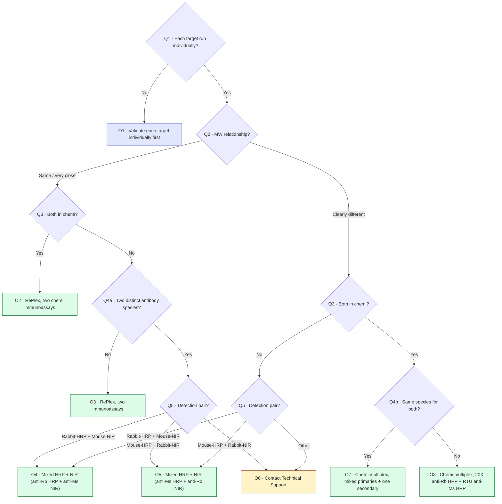

# Decision Tree Specification

| Document ID | FR-DOC-01 | Version | 0.1 (reflects V2 as deployed) | Status | Draft | Owner | H.-P. Konan |
|---|---|---|---|---|---|---|---|

## 1. Inputs (questions)

| ID | Code key | Question (UI text) | Options (value → label) | Helper text | Shown when |
|---|---|---|---|---|---|
| Q1 | `testedIndividually` | Have you run each target individually? | `yes` → Yes · `no` → No | Single-target validation is recommended before multiplexing so you can confirm expected peak position, signal strength, and antibody performance. | Always |
| Q2 | `mwRelation` | What is the MW relationship between the two targets? | `same_close` → Same or very close MW · `different` → Clearly different MW | — | Q1 = yes |
| Q3 | `bothInChemi` | Do you want both targets in chemiluminescence? | `yes` · `no` | — | Q2 answered |
| Q4a | `twoDistinctSpecies` | Do you have two distinct antibody species? | `yes` · `no` | Example: one rabbit primary and one mouse primary. | Q2 = same_close **and** Q3 = no |
| Q4b | `sameSpeciesForBothTargets` | Same species for both targets? | `yes` · `no` | — | Q2 = different **and** Q3 = yes |
| Q5 | `speciesPair` | Which mixed chemi / fluorescence setup matches your assay? | `rabbit_hrp_mouse_nir` → Rabbit-HRP + Mouse-NIR · `mouse_hrp_rabbit_nir` → Mouse-HRP + Rabbit-NIR · `other` → Other combination / not listed | Choose the option that best fits your intended detection setup. | (Q2 = different **and** Q3 = no) **or** (Q2 = same_close **and** Q3 = no **and** Q4a = yes) |

All inputs are single-choice selects with an empty default ("Select an option"). No free text is collected.

## 2. Decision flow

## 3. Path inventory

| Path | Questions asked | Number of questions | Outcome |
|---|---|---|---|
| A | Q1 | 1 | O1 |
| B | Q1, Q2, Q3 | 3 | O2 |
| C | Q1, Q2, Q3, Q4a | 4 | O3 |
| D | Q1, Q2, Q3, Q4a, Q5 | 5 | O4 / O5 / O6 |
| E | Q1, Q2, Q3, Q4b | 4 | O7 / O8 |
| F | Q1, Q2, Q3, Q5 | 4 | O4 / O5 / O6 |

Maximum depth: 5 questions (UR-10 met).

## 4. Output structure

Every outcome returns a `Result` object:

| Field | Type | Required | Description |
|---|---|---|---|
| `status` | `"recommended" \| "warning" \| "info"` | Yes | Drives the status badge: Suggested / Review needed / Next step |
| `title` | string | Yes | Headline of the recommendation |
| `recommendation` | string | Yes | What to do |
| `rationale` | string | Yes | "Why this path?" |
| `practicalTips` | string[] | No | Optional tips |
| `reagentNotes` | string[] | No | Optional reagent references |

A derived **decision type** (RePlex workflow / Mixed detection / Multiplex workflow / Review needed) is displayed as a second badge (see BR-06).
