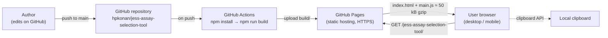
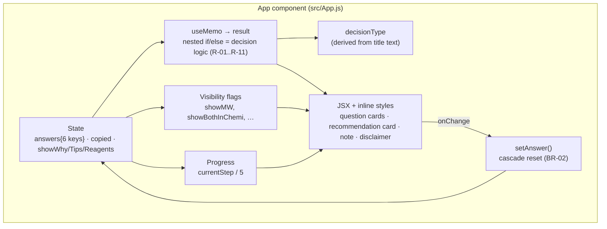

# Current-State Architecture (V2, as deployed)

| Document ID | SA-DOC-01 | Version | 0.1 | Status | Verified on 2026-10-24 | Owner | H.-P. Konan |
|---|---|---|---|---|---|---|---|

## 1. Overview

The tool is a **client-side single-page application** (React 18) built with **Create React App** (`react-scripts` 5.0.1) and deployed as static files to **GitHub Pages** by a GitHub Actions workflow. There is no backend, no database, no authentication and no data collection.

## 2. Runtime components

All logic runs in a single React component (`App`) in the browser:

## 3. Repository inventory

| Path | Role | Used in build? | Note |
|---|---|---|---|
| `src/index.js` | Entry point | **Yes** | CRA resolves `.js` before `.tsx` |
| `src/App.js` | **Deployed application (V2)** | **Yes** | Contains TypeScript syntax (`type`, annotations) inside a `.js` file |
| `src/styles.css` | Global CSS (2 rules) | Yes | |
| `public/index.html` | HTML shell, title, meta description | Yes | |
| `src/App.tsx` | Older version (V1) | No | Diverges from App.js (e.g. HRP + HRP rule, no copy/reset/progress) |
| `src/index.tsx`, `src/index2.tsx`, `src/index22.js` | Alternative entry points | No | Leftovers |
| `App.tsx`, `index.tsx`, `styles.css` (root) | Copies of V1 files | No | Outside `src/`, ignored by CRA |
| `tsconfig.json` | TypeScript config (`strict`) | Not effective on deployed code | Deployed code is `.js` |
| `package.json` | Dependencies, scripts, `homepage` | Yes | Name/description inherited from a starter template |
| `.github/workflows/deploy.yml` | CI/CD to GitHub Pages | Yes | Node 20; no test or lint step |
| `README.md` | — | — | Contains only a title and "test" |

**Verification (2026-10-24):** a clean `npm install` + `npm run build` of commit `533837d` compiles successfully (main bundle ≈ 49.85 kB gzipped) and the bundle contains V2-only strings ("Copy recommendation"), confirming that `src/App.js` is the deployed version.

## 4. Build and deployment pipeline

| Step | Tool | Detail |
|---|---|---|
| Trigger | GitHub Actions | Push on `main` (no pull-request gate) |
| Install | `npm install` | No lockfile committed → non-reproducible dependency versions |
| Build | `react-scripts build` | `homepage` sets base path `/jess-assay-selection-tool/` |
| Publish | `actions/upload-pages-artifact@v3` → `actions/deploy-pages@v4` | `build/` folder |
| Quality gates | — | **None** (no tests, type check, lint, audit) |

## 5. Key characteristics

| Aspect | Current state |
|---|---|
| Data | None stored; all state in memory, lost on reload |
| Scientific logic | Hard-coded nested conditions inside the UI component |
| Content | Outcome texts and reagent references duplicated inside each branch |
| Styling | Inline style objects; fixed two-column grid; no breakpoints |
| Accessibility | Native selects (good baseline) but labels not linked to controls; collapsible headers without ARIA state |
| Observability | None (no analytics, no error reporting) |
| Versioning | No releases, tags, changelog or rule-set version |

## 6. Assessment

| Strength | Weakness |
|---|---|
| Zero infrastructure cost; HTTPS by default | Logic, content and UI are entangled → hard to review scientifically and risky to change |
| Fast to load; no login friction | No automated safety net; any push deploys straight to production |
| Simple, understandable decision flow | Two divergent versions in the repository |
| Automatic deployment | Deprecated build toolchain (Create React App) |

Detailed debt items: `04-technical-debt-register.md`.
