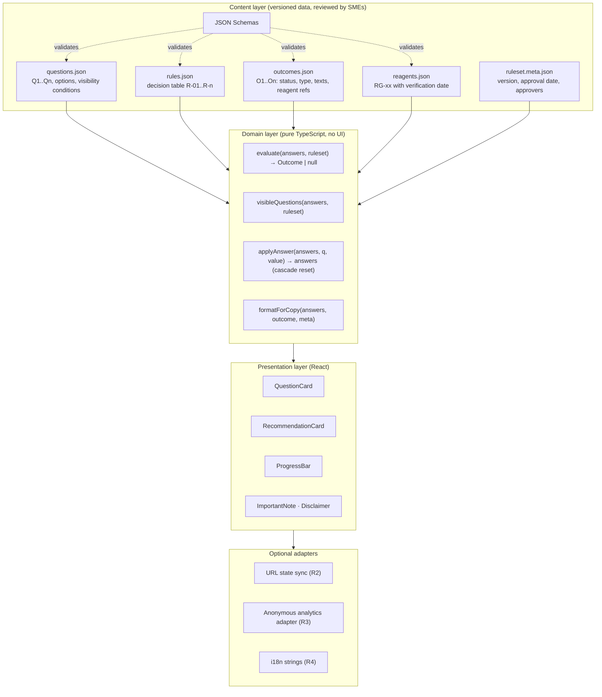
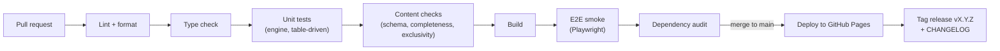

# Target Architecture

| Document ID | SA-DOC-02 | Version | 0.1 | Status | Proposed | Owner | H.-P. Konan |
|---|---|---|---|---|---|---|---|

## 1. Architectural goals

| Goal | Driven by |
|---|---|
| Separate **scientific content** (rules, outcomes, reagents) from **code** | NFR-09, PD-08, RK-01, RK-02 |
| Make the decision logic a **pure, fully tested function** | NFR-10, RK-05 |
| Stay **static and backend-free** until Stage 2 | NFR-02, NFR-07, ADR-001 |
| Make every result **traceable** to a rule-set version | NFR-11, UR-19 |
| Be **responsive and accessible** | NFR-03, NFR-04 |
| Allow **reuse** of the decision engine by other tools | Strategic pillar 5 |

## 2. Logical architecture



**Key rule:** the presentation layer never contains scientific conditions. It asks the engine which questions to show and which outcome applies.

## 3. Data model (simplified)

```ts
type AnswerSet = Record<QuestionId, OptionId | undefined>;

interface Question {
  id: QuestionId;              // "Q1"
  key: string;                 // "testedIndividually"
  text: string;
  helper?: string;
  options: { id: OptionId; label: string }[];
  visibleWhen: Condition;      // e.g. { all: [{ q: "Q2", eq: "same_close" }, { q: "Q3", eq: "no" }] }
  order: number;               // used for cascade reset and numbering
}

interface Rule {
  id: RuleId;                  // "R-04"
  when: Condition;             // complete answer pattern
  outcome: OutcomeId;          // "O4"
  constraints: string[];       // ["SC-04", "SC-05", "SC-08"]
}

interface Outcome {
  id: OutcomeId;
  status: "info" | "recommended" | "warning";
  decisionType: "validation" | "replex" | "mixed" | "multiplex" | "support";
  title: string;
  recommendation: string;
  rationale: string;
  tips?: string[];
  reagents?: ReagentId[];
}
```

### Example rule (R-04)

```json
{
  "id": "R-04",
  "when": { "all": [
    { "q": "Q1", "eq": "yes" },
    { "q": "Q2", "eq": "same_close" },
    { "q": "Q3", "eq": "no" },
    { "q": "Q4a", "eq": "yes" },
    { "q": "Q5", "eq": "rabbit_hrp_mouse_nir" }
  ]},
  "outcome": "O4",
  "constraints": ["SC-04", "SC-05", "SC-08"]
}
```

### Static integrity checks (run in CI)

1. Every rule references an existing outcome; every outcome references existing reagents.
2. **Exclusivity:** no answer set matches more than one rule.
3. **Completeness:** every complete answer set reachable through visible questions matches exactly one rule (enumerated exhaustively — the space is small).
4. Every outcome is reachable.
5. Every reagent shown in production has `verifiedOn` set.

## 4. Source layout (target)

```
/
├─ content/                 # scientific content — reviewed by SMEs
│  ├─ questions.json
│  ├─ rules.json
│  ├─ outcomes.json
│  ├─ reagents.json
│  ├─ ruleset.meta.json
│  └─ schemas/*.schema.json
├─ src/
│  ├─ engine/               # pure functions + unit tests
│  ├─ components/           # React components
│  ├─ styles/               # design tokens, CSS modules
│  ├─ adapters/             # url-state, analytics (optional)
│  └─ main.tsx
├─ tests/e2e/               # Playwright scenarios TS-01..TS-26
├─ docs/                    # this product dossier
├─ CHANGELOG.md
└─ .github/workflows/ci.yml # lint → typecheck → test → content checks → build → deploy
```

## 5. Delivery pipeline (target)



- `main` is protected; changes arrive through pull requests.
- A change in `content/` requires an SME approval (CODEOWNERS file listing reviewers).

## 6. Deployment view

| Stage | Hosting | Notes |
|---|---|---|
| Stage 0–1 | GitHub Pages (current) | Free, HTTPS, public URL |
| Stage 2 | Approved company channel (to be defined with IT) | Static bundle is portable to any static host or intranet |

## 7. Cross-cutting concerns

| Concern | Approach |
|---|---|
| Privacy | No personal data; analytics events limited to `{event, questionId, optionId, outcomeId, rulesetVersion}`; cookie-less provider or self-hosted counter (ADR-006) |
| Security | No secrets in the client; dependency audit; Subresource Integrity for any external script |
| Accessibility | Semantic HTML, linked labels, `aria-expanded` on collapsibles, focus management after outcome |
| Versioning | Semantic versioning for the app; independent rule-set version shown in UI and copied text |
| Reuse | Engine + content packaged so another app (e.g. a knowledge-base or report tool) can import `evaluate()` |

## 8. Migration path from current state

| Step | Change | Risk control |
|---|---|---|
| 1 | Freeze V2 behaviour with characterization tests on `src/App.js` (TS-01..TS-11) | Tests document current outputs before refactoring |
| 2 | Remove obsolete files (V1, extra entry points) | Build check |
| 3 | Extract outcomes, rules, questions and reagents to JSON; implement engine; re-run tests | Same outputs as step 1 (except approved wording fixes) |
| 4 | Migrate build tool to Vite + strict TypeScript | Visual and E2E comparison |
| 5 | Add CI gates, branch protection, CODEOWNERS | — |
| 6 | Apply R1 fixes (LI-01..LI-07) and responsive/accessible layout | Tests updated with the decision log |
